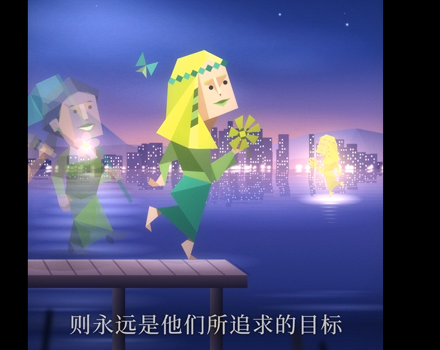
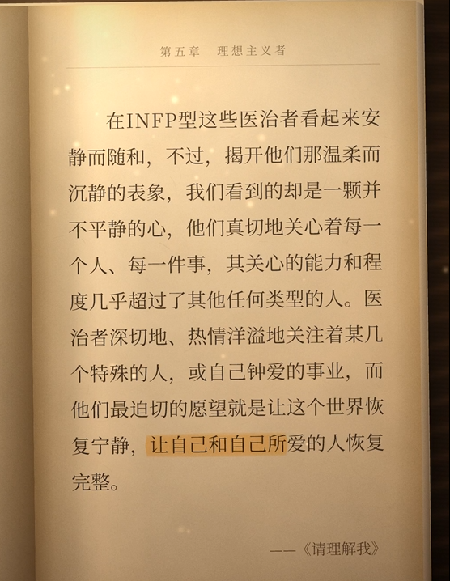
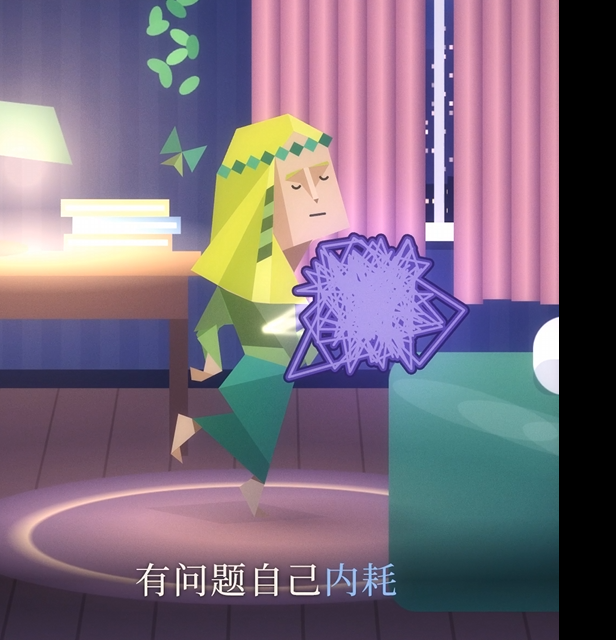
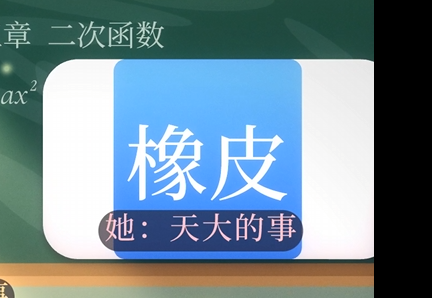
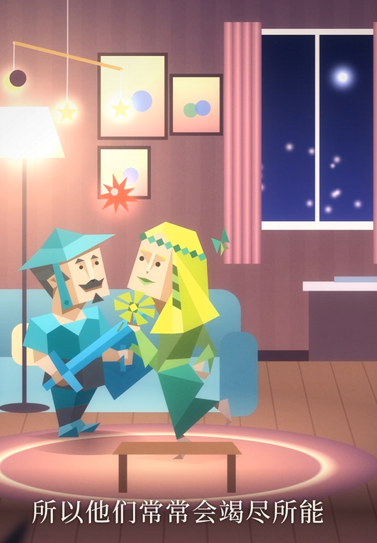
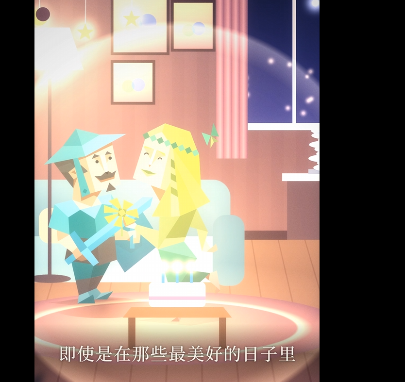

# INFP 视频修改反馈

共 13 条用户反馈、12 张截图。下面仅整理用户意见，不含额外设计建议。请逐条结合截图修改，不要只读文字。

本轮反馈优先于旧交接，尤其是书页：用户这次明确要求检查病句、错句和分页，不能继续按旧交接中的“书页别动”处理。

时间保留用户原述；代码定位已按 `89d5668` 核对，仅辅助查找。若时间点对不上，以对应台词和截图找到镜头，不擅自更改反馈含义。代码路径均相对于工程根目录。

## 01｜三大自我形象：运镜太快

定位：用户标注 **1:47**；B05“情感共鸣、慈善，以及真实可信，是他们的三大自我形象”。`src/demos/PWG2.js`、`PWS_g2b.js` 及前后相邻镜头。

前后镜头的运镜有点快，尤其是后面那次，影响视觉效果。调整这两处运镜速度。

## 02｜追求自我身份：金色 INFP 效果一般

定位：B07“而自我身份，则永远是他们所追求的目标”。`src/demos/PWS_g2c.js`。

目前用金色 INFP 表现自我身份，效果一般，需要继续优化这种表现形式。

## 03｜全部书页：病句与文字分配

定位：所有书页，不只截图这一页。`data/voice/pages4.json`、`src/demos/PWB.js`。

- 有病句或错句，直接做简单修改。
- 有时前一页只剩一半就接到后一页的一半，观感奇怪。重新考虑文字分配和分页衔接。

## 04｜自己内耗、自己思考：乱线效果需要优化

定位：用户标注 **1:27**；C101“有问题自己内耗，自己疏导”及相邻思考段。`src/demos/PWS_g3a.js`。

目前画面是一堆乱七八糟的线，效果还有优化、改进空间。

## 05｜字幕：不要把一句话切到两个画面

定位：全片字幕和镜头衔接。截图例句为 C205“因为维护过多或过于复杂的关系，会让他们精疲力竭”；截图停在“因为维护过多或过”。字幕总装在 `src/demos/PW.js`，时序在 `data/voice/voice_timed4.json`。

适当调整字幕与镜头的衔接，不要让本来完整的一句话被切到两个画面里。

## 06｜巨大橡皮：看不懂在表达什么

定位：**3 分钟前后**；C307 附近的巨大橡皮。`src/demos/PWS_g4a.js`。

用户不知道那么大的橡皮是什么意思，画面本身没有表达清楚。重新思考、优化这一部分的代码效果和画面设计。

## 07｜INFJ 关注人生道路：手部表现廉价

定位：**3:25**；D01“不同于 INFJ 们对于人生方向和正确道路的关注和推演”。`src/demos/PWS_g4b.js`。

手部看起来像一根棕色像素线上下位移，效果过于廉价。需要其他设计或表现方式。

## 08｜紧接着的 INFP：指南针、强光和理想冲突

定位：紧接上一条的 D02–D03。`src/demos/PWS_g4b.js`。

- 指南针看不清，黄色光太亮，画面也有点挤。需要调整。
- 随后的“现实选择和内心理想经常会冲突”，用户只看到一堆光线。重新思考适合这句文案的效果。

## 09｜理解他人与亲人的牺牲：重新考虑表达方式

定位：**4:05** 附近；D10–D11 新观点、了解他人及感受，以及 D16“他们的亲人也必须做出牺牲”。`src/demos/PWS_g5a.js`。

- 了解别人的观点、感受，应该有比纸飞机和发光更好的表现方式。
- “亲人的牺牲”用一张卡片弹出来，效果也不好。重新思考画面表达。

## 10｜伴侣：避免矛盾与感知情绪

定位：E02“尽量避免家庭矛盾的产生”、E04“敏锐地感知配偶的情绪”。`src/demos/PWS_g5b.js`。

- 避免矛盾产生的效果一般，需要优化。
- 感知配偶情绪时，眼睛放光的效果看不出来，换其他表现方式。

## 11｜最美好的日子与惶恐不安：没有表现出来

定位：E08–E09，“即使是在那些最美好的日子里，他们也常常会惶恐不安”。`src/demos/PWS_g5b.js`。

现有画面、场景、背景和代码效果，没有表现出“最美好”；后面的“惶恐不安”也需要改进。

## 12｜保护精力：火苗与罩子的表达不够合适

定位：**5:21** 附近；F01“保护好自己的精力”。`src/demos/PWS_g6.js`。

目前用火苗和被罩住的效果表现精力。需要认真重新思考足够合适、效果好的表达方式。

## 13｜最后一句与删文案

定位：**6:11**，“直至形成他们脑海中的各种印象”。已核实这句话位于 `data/voice/pages4.json` 的 **P5 书页**，不是配音台词 ID。本条没有单独截图。

**以“直至形成他们脑海中的各种印象”为最后一句，后面的文案全部删除。**
