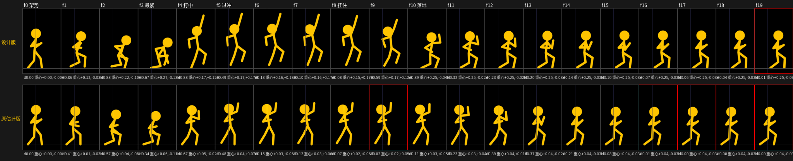

# 动作设计：怎么设计、怎么做出 Alan Becker 那样的动作

> 一句话：**像手绘动画师一样工作**——先设计姿势和节奏，再用代码一张一张"画"出来；参考片主要用来学"他为什么这么设计"，数字用来校准和验收。
> 第 1 节是设计方法（有没有原片都能用），第 2 节是用我们的代码怎么实现，第 3 节是怎么用参考片提升，第 4 节是积累方式，第 5 节是动作卡（每个动作的设计拆解）。
> 逐帧数据和展板在 `研究/动作逐帧_四集.md`（证据），招式数据在 `analysis/fight_moves.json`。

## 0. 为什么要换做法

- **Alan 的动作是手绘的"关键画 + 定格"**：24fps 每帧一张新画，几个极限姿势之间 1–3 帧切过去，到了就衰减几帧然后**一动不动**。观众看到的是一张张有力的画和中间的停顿。
- **我们原来的系统是"意图 + 弹簧 + 60fps 插值"**：什么动作都被抹成缓入缓出，停下来还在微晃 → **软、飘、匀**。最直接的证据是弓步刺：原片第 1 帧就是全速（帧间差 d=0.89），我们原来估计的版本 d=0.55 慢慢起、先往后拉 3 帧、第 7 帧才刺中（`研究/动作逐帧_四集.md` B 节对比图）。
- **分工**：快动作（打、扑、摔、吓、撞）用**按帧号写的关键画**（`fight.js` 的 keys，24fps），出画 `step: 24`；慢动作和表演（走、看、想、挠头）继续用弹簧意图——弹簧负责"活"，关键画负责"力"。

## 1. 设计一个动作：七个问题

不管有没有原片，按顺序回答这七个问题，答案就是这个动作的设计稿（写进第 5 节的动作卡）。

**① 一句话意图**：谁、想干什么、观众要看懂什么、什么情绪。意图决定能量：高能量一拍一（每帧新画），低能量（趴着喘、爬、犹豫）一拍二 / 一拍三（动一下停 2–3 帧）。
> 弓步刺："橙色想一剑结束战斗，很自信" → 快、直、长。

**② 先设计"一张就说完"的画（招牌姿势）**：这一帧单独截出来也看得懂。检查三样：
- **动作线**：从着地的脚到出力的手是一条直线或一条弧。弓步刺刺中帧：后脚—胯—肩—剑手几乎一条直线，横跨 1.4H、高只有 0.7H。
- **剪影**：手脚不压在身体上，展开、不对称；一只手出去，另一只往反方向甩（对抗、平衡）。
- **敢作弊**：手脚画长（弓步刺剑手离肩 0.53H，我们的手臂只有 0.375H）、身体完全水平（鱼跃）、整个人贴平（撞方块）。只有 1–2 帧，观众看不出来，只觉得有力。

**③ 在它前面放一张"最收紧"的画**：展开之前先缩成一团，收和放的反差就是力量。弓步刺 f2–f3：后腿收在胯下、剑收在胸前；滚之前缩成球；吓跳的第一帧手缩到头边。
- **收紧不等于往后拉**。原片的规律是：**主方向上一直前进，预备放在别的方向**——弓步刺胯每帧 +0.12–0.15H 一直往前，"预备"只是上身先直起来、往上提一点。往后拉 3 帧再出手，等于告诉对手"我要打了"，节奏也拖慢了（我们原来的估计版就是这个毛病）。

**④ 排节奏（24fps 帧号表）**：先定哪里停（定格是标点，观众在定格里看懂姿势），再排快的部分。原片量出来的常用帧数：

| 段 | 帧数（24fps） | 出处 |
|---|---|---|
| 起动 | 0–2 帧（打人的快动作第 1 帧就全速；整个人起跳是"慢两帧再猛冲"） | B、A |
| 收紧 → 招牌姿势 | **1 帧**（最快的一下只要 1 帧：剑手 1 帧伸出 0.7H，鱼跃 1 帧前移 0.34H） | B、F |
| 过冲 | 1 帧（到了还往前走一点） | B f5 |
| 衰减落定 | 4–8 帧，变化量一路减小（0.7 → 0.3 → 0.1 → 0） | C、F |
| 定格 | 12–27 帧（0.5–1.1 秒），完全不动 | A、C |
| 摔、翻、滚 | 全程一拍一，约 1 秒；滚一圈约 6 帧 | D、F |
| 爬起来 | 7 帧，站直后衰减 10 帧 | F |
| 冲刺 | 每步 4 张画，两条腿共用 | D |

打斗交锋的帧数（第 5 轮从三集打斗段量的，拆解 3.5）：出招 1–2 帧；预备 2–5 帧，约是出招的 2–3 倍；收招 5–6 帧；快拍 3–6 下之后一定停（**第 8 轮作废**：用户明确说"打架中间是没有停顿的"——停换成仍在动的段落：锁剑较劲、滑退、滑行跪地；见 `剧本/打斗试做_duel2.md`）。"预备"和上面"不往后拉"不冲突：预备的帧数要够，但它是往别的方向（弓步刺的 3 帧预备是往前踏、上身直起来），不是往后拉。

**⑤ 身体各部分的先后**：
- **主动出力：从根到梢**。脚和胯先走，上身后到，手（武器）最后"啪"一下到。弓步刺 f1–f3 只有脚和胯在走，f3→f4 上身从 22° 压到 57°、剑手伸直、前脚落地——**接触帧 = 所有部分同时到达**。
- **被动受力：从接触点往外传**。撞上方块后，头和上身先弹回来，胯和脚还在原地，手还朝前伸（E）。
- **头最软，晚一帧**：出招后才抬头看对手，被打后最后甩回来。

**⑥ 每段选一条运动曲线**（同样的距离，曲线不同就是不同的物理）：

| 情况 | 曲线 | 原片的数（每帧位移） |
|---|---|---|
| 自己发力（出拳、扑） | 一开始最快（`out`） | B 剑手 1 帧到位 |
| 重力下落 | 越落越快（`in`） | A 下落 +0.03, +0.07, +0.10, +0.14H |
| 贴地滑行 | 几乎匀速，到停突然停住（`linear`） | F 仰面滑 0.09H/帧 |
| 被推开 | 缓出（`out`） | F -0.24, -0.11, -0.09, -0.07… |
| 落定 | 衰减（`out`，或每帧写一个越来越小的变化） | C 0.74, 0.10, …, 0 |

**⑦ 反应和镜头一起设计**：
- **反应比出招长**：出招 4 帧，被打飞到趴下 28 帧——观众看的是后果。笑点通常在反应后面的定格里（C 扑空后趴着定 1.1 秒）。
- **镜头也表演**：撞上大东西时（E 撞方块）画面上下震 1–2 帧（0.02–0.05H）；跟拍的镜头撞上后用约 0.6 秒缓出停下；动作完了再用 0.7 秒左右把构图摆正（E、F）。
- **打斗交锋不一样**（拆解 3.5）：打中**不停帧、不震屏**，打击感靠 1 帧光 + 火花 + 字形和"快 + 停"；回合内镜头不动，只在被打飞时 6–12 帧拉远。"差一点"比打中多。

### 例：没有原片，按七个问题设计上勾拳（`uppercut_d`）

| 问题 | 设计 |
|---|---|
| ① 意图 | 终结招，把对手打上天；高能量，一拍一 |
| ② 招牌姿势 | f4：从脚到拳头一条竖线——拳在头顶前上方、手臂拉长 1.4 倍、另一只手往下甩、前膝提起 |
| ③ 收紧 | f2–f3：前脚踏进、后脚跟上，蹲成一团，拳在膝盖边，头低着；胯一直往前走，不往后拉 |
| ④ 节奏 | f1–f3 收（3 帧）→ f4 一帧打到底 → f5 过冲跳离地面 → f5–f8 在最高点挂住（衰减）→ f8–f10 落下 → f10 落地压一下 → f11–f18 衰减回架势。节奏借的是 B 弓步刺（3 帧收、1 帧到、过冲 1 帧） |
| ⑤ 先后 | 腿和胯先蹲进去，f4 胯弹起、上身后仰、手臂伸直同一帧到；头晚一帧（f5）抬起来看对手 |
| ⑥ 曲线 | 收：`out`；挂住：衰减；落下：`in`（像重力）；回架势：`out`（衰减，不用 `inOut`） |
| ⑦ 反应 / 镜头 | 对手 `launch_up` / `launched`（被打飞）；`exchange` 里 level 用 `heavy`：1 帧全屏白闪 + 火花，**不停帧不震屏**（拆解 3.5 实测）。镜头回合内不动，对手被打飞时 6–12 帧拉远——还没做 |



上面一行是设计版，下面是原来的估计版（每格下面是帧间差 d 和重心位移）。设计版的 d：快段 0.86, 0.88, 0.67, 0.88 → 挂住 0.49, 0.13, 0.10, 0.08 → 下落 0.59, 0.89 → 落定 0.32, 0.23, 0.20, 0.14, 0.10, 0.07, 0.06, 0.04, 0.01——和原片"快段 → 衰减 → 定住"的指纹一样。估计版最快的一帧只有 0.67，中间和结尾都有死停（红框）而不是衰减。
做的过程中改过一次：第一版只给胯写了"挂住"，手和脚没写，结果挂住的 3 帧手在慢慢往下飘（d 0.24, 0.24, 0.33）；后脚没跟上，"最紧"的那张其实是个弓步。这两条都记进了第 2 节的坑。

## 2. 用我们的代码实现

### 设计 → 代码

| 设计里的东西 | 怎么写 | 状态 |
|---|---|---|
| 关键画 | `analysis/fight_moves.json` 里一个招式；快的部分**每帧一个 key**（字段见 `render/src/fight.js` 开头） | 有 |
| 一拍一硬切 | `actor.draw(ctx, t, { step: 24 })`：两张画之间不插值 | 有，`SCENE=duel1` 已开（第 7 轮） |
| 一拍二 / 一拍三 | 那一段用 `step: 12` / `step: 8` | 有 |
| 1 帧到位 | 相邻两个 key 只差 1 帧 | 有 |
| 过冲、衰减 | 写出来（几个越来越小的 key），或者招式结束后交给弹簧 | 有 |
| 运动曲线 | key 的 `e`：`out` / `in` / `inOut` / `linear` | 有 |
| 定格 | 每个通道写同样的值；角色 `noise: 0`（原片定格一动不动）。打斗里打中**不**用 freeze 停帧（拆解 3.5），定格靠两招之间的"停" | 有 |
| 手脚拉长（作弊） | key 里写 `st: 1.4`：够不着目标时手脚拉长，最多 1.4 倍；招式结束自动回 1 | 第 6 轮新增 |
| 转身 1 张压扁的画 | `draw(ctx, t, { step: 24, turn: 0.4 })`：转身后第一张画关节往胯收拢 | 第 6 轮新增 |
| 身上不拖影 | `draw(ctx, t, { smear: false })` | 有 |
| 架势高度 | key 的 `hipY`：胯离地的绝对高度（H 的倍数），重复调用不会越来越低；脚距按腿长算 | 第 7 轮新增 |
| 手 / 兵器的位置 | key 的 `F` / `B` 是**世界方向**（不随前倾转）；兵器沿"肘 → 手"方向。想要剑尖到某处：`tools/hand_for.js` 反求 | 第 7 轮新增工具 |
| 出手距离 | 招式的 `reach`（含兵器长）或 `move(t, 名, { reach })` 覆盖；`exchange` 每拍写 `tip: 剑长`。校：`tools/contact_check.js` | 第 7 轮新增 |
| 武器拖影（剑扫过的白色扇形 1–2 帧） | `fight.js` 的 `drawWeapon`（1 帧拖影；`trail: false` 不画） | 有（第 5 轮） |
| 剑的角度和前臂无关（劈、撩、横扫的大弧线） | key 的 `wa`：剑角（0 = 指前方，90 = 朝天，180 = 指身后；可以超过 ±180 转整圈）。不写就是旧的"沿前臂" | 第 8 轮新增 |
| 前手位置按"胯前多少、离地多高"写 | key 的 `h: [胯前, 离地]`（代替 `F`，按这一帧的胯高和前倾换算）；设计劈砍比 `F` 直观 | 第 8 轮新增 |
| 双手握剑 | key 的 `g2: 0.07`（两手间距），后手自动放在剑柄末端；`_a` 招合并时默认加上 | 第 8 轮新增 |
| 透视缩短（横扫时剑指向镜头） | key 的 `wl`：剑看起来的长度倍数（0.2–0.4 = 指向镜头），最后一个 key 回到 1 | 第 8 轮新增 |
| 招式里转身（回转斩） | key 的 `turn: true`：这一帧朝向翻过去；之后 F / B / lean / wa 按新朝向写 | 第 8 轮新增 |
| 脚贴地滑（滑退、踏步滑进） | key 的 `slide: true`：从上一个 key 到这一帧脚贴地滑，不抬脚 | 第 8 轮新增 |
| 空中收腿、翻滚 | key 的 `fr: true`：这一帧脚按身体写（[沿身体朝前, 沿身体朝上]，跟着 lean 转） | 第 8 轮新增 |
| 胯走远了脚自动跟一步 | 没写某只脚、腿够不着时自动补一步；叠招时，后一招接管的脚会作废前一招排在后面的落地 | 第 8 轮新增 |
| 大弧线的月牙拖影 | `drawWeapon(ctx, a, ta, { arc: true })`：最近 1.5 帧剑扫过的面；`arcFrom` 跳变（剑一帧变长）之前不算 | 第 8 轮新增 |
| 打斗平滑跟拍 | `D.follow(t0, t1, { on: [a, b, 剑尖函数], kind: 'full', fit })`：逐帧取景 + ±0.25 秒滑动平均 | 第 8 轮新增 |
| 单手握刀剑（剑柄、护手、拳头、剑指、剑穗；刀单刃翻刃） | `actor.blade = { kind: 'jian' \| 'dao', tassel, zhi: true }`；场景里画兵器用 `drawWeapon(ctx, a, ta, { arc: true })` | 第 10 轮新增 |
| 肘跟着剑翻（剑举过头、剑尖指身后时肘翻上去） | 自动（`gripGrid`，3 帧换过去）；不要就写 `blade.elbow = false` | 第 10 轮新增 |
| 兵器画在身后（缠头裹脑、背刀） | 招式写 `behind: [f0, f1]`，场景用 `a.weaponBehind(ta)` 决定先画谁 | 第 10 轮新增 |
| 兵器脱手（磕飞、插地、踢起来、接住；断刀头） | `new FlyBlade(blade, 长度, H)`：`toss(…)`、`stick(dur)`、`hide(t)`；手里没剑时 `actor.weapon` 返回 0 只画拳头 | 第 10 轮新增 |
| 刀断了 | `blade.broken = { t, at: 0.3 }`：断口斜切、拖影只到断口 | 第 10 轮新增 |
| 慢镜头 | `clock.slow(ta, d, k)`：动画时间 ta…ta+d 按 k 倍速放；接触、音效照样写动画时间 | 第 10 轮新增 |
| 击中（1 帧光、火花、字形；重击再加 1 帧全屏白闪；不停帧不震屏） | `exchange(D, beats, fx)` + `FightFX`（level：`none` / `clash` / `hit` / `shot` / `heavy`） | 有（第 5 轮） |
| 镜头撞上后缓停、动作后摆正 | `cam` 的跟拍 + 缓动 | 部分有，待按 E 校准 |
| 冲刺 4 张循环 | — | 待做（现在的 `run` 是程序化的步子） |
| 橙色角色比例（头 0.32H） | — | 待做（`rig.js` 的 `P` 是黄色角色的比例） |
| 指定膝盖 / 手肘弯的方向、弯成弧线的手脚 | — | 待做 |

### 实现时的坑（做的时候踩到的）

1. **定格要每个通道都写一遍**：只给胯写了"停"，手会从上一个 key 慢慢走向下一个 key，定格变成"慢慢飘"。
2. **落定用 `out`，不用 `inOut`**：`inOut` 中间快，d 会先变大再变小，不像衰减。
3. **预备不要往后拉**：先往后拉几帧是我们估计动作时的老毛病，原片没有。
4. **拉长只写在极限帧附近**，后面几帧逐步写回 1；招式最后一帧还拉着的话，结束时会跳一下。
5. **量出来的数也要做出来对比**：弓步刺第一版量成"胯降 0.19H、前倾 64°"，做出来和原片同帧并排才发现是 0.11H、57°。
6. **黄色和橙色角色比例不同**（头 0.22H vs 0.32H），按 H 换算位置时，头大的角色重心更高，同一组数做出来前几帧重心会慢一点。
7. 体检（`qa.js`）的"身体瞬移"按 60fps 算：头 / 胯超过 0.6H、手脚超过 1.0H 才报（第 5 轮调的，出招时手脚一帧本来就能走 0.7H）。`step: 24` 下一张画停 2–3 个 60fps 帧再跳，跳的那一帧位移更大，被报出来时要人看一眼是不是故意的。
8. **招式要从当前实际位置起步**（第 5 轮踩的坑）：两个人重叠的动作一接，没从实际位置起步就会瞬移。`move()` 的 `to` 会自动补步子够到对手。
9. **橙色实测的架势放到黄色骨骼上会把胯压低**（第 7 轮，"架势偏低"的根因）：`fence_guard` 两脚分开 0.55H，黄色腿只有 0.44H，后脚够不着，IK 把胯压到 0.15H。架势的脚距按腿长算（脚离胯 < 0.97 × 腿长），胯高用 `hipY` 写死。
10. **原片的 `dodge_back` 会让人越蹲越低**：它是相对的"胯往下 0.04H"，连着闪几次就蹲下去了。回架势的招一律用绝对的 `hipY`。
11. **F 是世界方向、剑沿前臂**：前倾 40° 时写 `F[0.3, 0.1]` 仍是"往前 0.3H、往上 0.1H"。肘永远在肩–手连线的下后方，所以剑的斜度 ≥ 肩到手的斜度，**手高于肩时剑尖不可能朝下**。先用 `hand_for.js` 算能不能做到。
12. **1 帧打到的招，手也要 1 帧到位**：招式第一帧手默认 0.1 秒过渡，会让手晚 2 帧（打中时剑还在半路）。`fight.js` 已改成过渡不超过第一个 key 的时间。
13. **reach 含兵器长，要用 `contact_check.js` 校**：接触时胯间距 = reach − 招式自己在接触帧的胯前移。估出来的 reach 基本都差 0.2–0.4H，剑会穿过身体或隔空打中。
14. **碰剑要两把剑成 X、碰在身前**：来路是什么斜度，格挡就取相反斜度；碰剑点要在两人之间（不能贴着守方身体），所以碰剑那一刺比"闪开"那一刺站远约 0.3H。闪避要"差一点"：剑尖离身体 0.03–0.3H。
15. **一帧转太多像瞬移**：上身一帧最多转 35° 左右（弯腰被点头要 2 帧弹直）；一帧手要走 1.4H 的劈砍拆成 2 帧。
16. **打斗中不停**（第 8 轮，用户意见）：上一招的收势就是下一招的预备——剑停在哪儿，下一招就从哪儿起；守方的反应收在他下一招的起点。不要"回架势 + 定格"。`contact_check` 逐帧查"两人同时几乎不动超过 4 帧"。
17. **剑沿前臂只能做出击剑**（duel1 的根因）：刀剑的劈、撩、横扫要用 `wa` 单独写剑角，双手握（`g2`），手在身前，靠转腰和步子出力；单手直臂往前送就是击剑。
18. **剑尖不能插地**：每一帧要 手高 + 剑长 × `wl` × sin(`wa`) ≥ 0。长剑贴地兜过来的招（巨剑上撩）做不到真的贴地扫，就让剑先指向镜头（`wl` 0.2）再转出来。
19. **比例数字记住再设计**（黄色骨骼）：肩 = 胯 + 0.255H（沿上身），臂长 0.375H，腿长 0.437H；手的目标离肩超过 0.375H 就够不着（画出来手停在半路），脚离胯超过腿长就被拖直。先用 `tools/fight_probe.js` 看那几帧。
20. **碰剑碰在强弱处**：攻方剑的 70–85% 撞守方剑的 25–50%，`contact_check` 会反求守方接触帧该写的 `h` 和 `wa`。
21. **叠招时前一招的脚会"回来"**：后一招从半路接上时，前一招排在后面的落地还在，会把脚拽回去；`fight.js` 已改成后一招接管的脚作废前一招之后的落地。
22. **两把剑别共线**：闪开时守方的剑如果和攻方劈下来的剑几乎重合，画面上像碰剑——守方的剑要竖起来让开。
23. **写过 `hipY` 的招，后面的 key 也要写 `hipY`**（第 10 轮）：只写 `hip` 的 key 会回到招式开始的高度，胯塌下去再弹回来。
24. **单手剑的手离肩别超过 0.37H**：`h` 写得太远手会停在半路（剑看起来"没握住"）；`contact_check` 反求出来的 `h` 一般只要挪 0.01–0.03。
25. **剑横在头顶（云剑、托刀架）要透视缩短**（`wl` 0.35）：侧面看剑横过头顶会横穿半个画面、还会穿过对方的身体。
26. **刀剑一快就像打击乐**（设计时的判断，待看片验证）：单手剑一拍 4–5 帧可以连 3 拍（连环刺），再多看不清；连环段之间放一个"定一下"的架子（提膝挂剑、立剑），节奏才出来。
27. **兵器脱手那段，剑的位置要算进取景**：镜头 `on` 里加上飞着的剑（`fly.tip`），不然剑会飞出画面。
28. **手和剑别分开写**（第 11 轮）：`h` 和 `wa` 各写各的，腕角没人管，blade1 有 22%–41% 的帧腕角 > 60°（剑粘在手腕上转）。拿剑的人开 `actor.blade.solve`：剑的线不动，手沿剑滑、肘向连续选，腕角 ≤ 45°；挂剑这种本来就折腕的 key 写 `wr: 80`。
29. **2D 要自己管深度**（第 11 轮）：剑转到身体另一侧时会画在头前面（穿头）。开 `actor.blade.autoBehind` 按几何自动画到身后，不用一招一招写 `behind`。
30. **连贯的剑路别每个 key 都停**（第 11 轮）：默认 `out` 每个 key 速度归零，剑尖速度一帧一突变。开 `actor.blade.thru`：中间 key 样条穿过（保单调，不冲过头）；只用在手和剑，胯不用（招式常被中途接走）。贴地兜过来的一段显式写 `e: "out"`。
31. **两人戏没有"轮流表演"**（第 11 轮）：一个人动的每一下另一个人都要有反应（重心一坐、剑尖一压、退半步）。开场试探 > 各自亮相。`wrist_check` 的"独舞"帧数就是量这个的。

## 3. 怎么用参考片提升效果

1. **学设计思路，不只抄数**：学一个原片动作时，用第 1 节的七个问题去拆它（招牌姿势是哪一帧、收紧的是哪一帧、节奏表、先后、曲线、反应和镜头），写成动作卡。数字会过时、会量错，"为什么这么设计"能用到没有原片的动作上。
2. **节奏借原片，姿势自己设计**：做新动作时先在第 5 节找最像的原片动作，借它的帧数结构（几帧收、几帧到、停多久），姿势按自己的意图设计。上勾拳就是这么做的。
3. **闭环验收**：`move_seq.js` 按 24fps 渲出来 → `ref_compare.py` 和原片同帧并排，看 d 和重心路线 → 改 → 再比。有原片对原片；没有原片就比"指纹"：快段 d 0.5–0.95、落定一路减小、定格 0。
4. **原片里有、我们做不出的效果，加成通用能力**（这次的拉长、转身压扁），而不是在某个场景里硬凑。下次所有动作都能用。

## 4. 积累方式

每学一个、或者设计一个动作，留下这几样：

| 层 | 放哪 | 内容 |
|---|---|---|
| 方法 | 本文件第 1–3 节 | 七个问题、设计 → 代码对照、坑。学到会改变做法的东西就改这里 |
| 动作卡 | 本文件第 5 节 | 每个动作的设计拆解（七个问题的答案）+ 实现名 + 证据 + 状态 |
| 招式数据 | `analysis/fight_moves.json` | 能直接用的 key；"来源"写清是实测还是设计 |
| 能力 | `render/src/`（`rig2.js`、`actor2.js`、`fight.js`） | 通用的新能力（`st`、`turn`、`step`…），默认关，旧片不受影响 |
| 证据 | `研究/动作逐帧_四集.md` + `研究/动作逐帧/*.svg` | 逐帧数据、展板、对比图（`bash analysis/motion_boards.sh` 重新生成） |
| 工具 | `analysis/ref_*.py`、`render/src/tools/move_seq.js` | 学习闭环（第 6 节） |

## 5. 动作卡

格式：意图 ｜ 招牌姿势 ｜ 收紧 / 预备 ｜ 节奏 ｜ 先后和曲线 ｜ 实现 ｜ 状态。原片时间和逐帧数据见 `研究/动作逐帧_四集.md` 对应字母。

第 5 轮的招式库里已有一批实测招式（兵器招 `thrust` / `slash` / `upswing` / `parry`，闪躲 `lean_dodge`，受击 `stagger` / `hurt_fold` / `launched` / `knockdown_quick` / `hit_fall_back`，`tackle`、`dive`、`startle_sit` 等，数据在 `研究/打斗拆解_*.md`）。它们还没写动作卡；以后用到哪招，就按七个问题补一张卡、做一次同帧对比。

**B 弓步刺**（数学集 7:28.3）
- 意图：一剑结束；快、直、长。
- 招牌姿势：f4 刺中——后脚到剑手一条直线，前倾 57°，胯降 0.11H，剑手 0.53H（拉长）。
- 收紧：f2–f3 后腿收在胯下、剑收在胸前；预备是上身先直起来（37° → 22°），不往后拉。
- 节奏：3 帧跨步 → 1 帧刺到 → 过冲 1 帧 → 往回收 3 帧。后腿从身下穿过去变成新的前腿，前脚落地 = 刺中。
- 实现：`fence_guard` + `lunge_step`（实测，f3–f8 写了 `st`）。状态：已和原片对比，d 和重心路线对上。

**设计 上勾拳**（无原片，见第 1 节例子）
- 实现：`uppercut_d`。状态：动作本身做完；对手反应和镜头往上跟还没配。
- 注意：原片打斗几乎没有拳脚（拆解 3.5），这张卡是"没有原片时怎么设计"的练习。兵器招（`thrust`、`slash`、`upswing`）可以按同样的方法重做一遍。

**第 7 轮 duel1 的设计招**（无原片，按七个问题设计；每招七问摘要见 `剧本/打斗试做_duel1.md`，完整说明在 `fight_moves.json`）
- 架势：`duel_guard_d`（主角，胯 0.36H、前倾 30°）、`idle_guard_d`（强者懒架势，几乎站直、剑垂着）、`fence_advance_d`（前脚先、后脚跟，一步 5 帧）。
- 进攻：`lunge_d` / `lunge_fin_d`（标准弓步刺，不换脚，2 帧收 → 1 帧刺）、`cut_d`（斜劈，预备往上）、`rise_cut_d`（上挑，预备往下）、`flail_d`（气急重劈砸地，预备 4 帧）、`tap_d` / `tap_low_d`（强者轻蔑一点）、`upswing_d`（强者第一次迈步的上撩）。
- 防守：`flick_parry_d` / `flick_high_d` / `flick_low_d`（只动手腕，剑成 X，接触前 1 帧起手）、`step_back_d`（退半步，剑不抬）。
- 反应（逐级加重）：`flinch_d` → `bonk_back_d` → `launched`；`recoil_d`（强者愣 6 帧才反应）。
- 表演：`look_sword_d`、`heft_d`（剑突然变重：手先被拽、上身晚 1 帧、头最后）、`victory_raise_d`、`topple_back_d`（晃 `inOut` → 倒 `in` → 弹一下）。
- 状态：`contact_check` 和 `qa` 全过；**还没看过视频**，等用户本机渲染后按反馈改。

**第 8 轮 duel2 的设计招**（动漫刀剑，双手握，30 个 `_a` 招；节拍表和每招要点见 `剧本/打斗试做_duel2.md`）
- 架势：`ready_a`（正眼，剑尖指眼睛 35°）、`hasso_a`（八相，剑竖在右肩旁）——都在微微下沉，不是定格。
- 进攻：`dash_cut_a`（拖刀冲刺 + 逆袈裟，两人对冲撞 X）、`down_cut_a`（袈裟斩）、`riposte_a`（剑绕头顶反劈）、`thrust_a`、`h_cut_a`（横斩，透视）、`rise_cut_a`（蹲起上撩）、`overhead_a`（唐竹）、`shove_a`、`leap_cut_a`（跳劈劈地）、`tsubame_a`（燕返し）、`spin_cut_a`（回转斩，`turn`）、`dash_a` / `leap_air_a`（冲刺、跳起补刀）、`big_rise_fall_a`（巨剑上撩 + 被剑带倒）。
- 防守 / 反应：`block_slant_a`、`parry_up_a`、`block_low_a`、`block_high_a`、`guard_break_a`（挡住但剑被磕飞）、`sway_back_a`、`duck_a`、`hop_back_a`、`slide_back_a`、`knock_skid_a`（低飞 → 单膝跪滑）、`launched_air_a`（空中被打飞后翻，`fr`）。
- 锁剑：`lock_hero_a` / `lock_foe_a`（14 帧一直在抖、一点点被压）；过渡：`lower_trail_a`。
- 状态：`contact_check`（12 拍 + 逐帧）和 `qa` 全过；**还没看过视频**，等用户本机渲染后按反馈改。

**A 吓得跳起、往后跌坐**（几何集 4:02.5）
- 意图：被吓到，不受控制。招牌姿势：空中手缩在头边、腿蹬直。
- 预备：没有。定格 16 帧后第 1 帧就反应（手瞬间到头边），起跳慢两帧再猛冲。
- 节奏：9 帧从动到坐地；上升 0.21H、后退 0.29H；下落越来越快（`in`）；着地后一拍二慢慢稳住；镜头 6 帧拉远。
- 实现：`acting.js` 的 `startle` 是原地缩一下（编程集那种）；第 5 轮招式库的 `startle_sit`（几何集实测：缩身 1f、后仰 1f、空中 5f、落地坐、定格 7f）就是跳起跌坐，**还没和这里的 A 同帧对比**。

**C 冲过去扑空 → 回身扑 → 趴着**（数学集 1:50.6）
- 意图：抓东西，急。招牌姿势：反身扑出去，身体几乎水平。
- 节奏：起跑 4 帧到全速（每步约 3 帧，上身压低、双手往前伸）；扑空刹车 → 回头 → **1 帧压扁转身** → 扑出去约 10 帧；趴着衰减 20 帧 → 定 4 帧 → 抬头 → 塌下去衰减 8 帧 → **定 27 帧（1.1 秒，笑点）**。
- 实现：转身用 `turn`；扑可以从第 5 轮的 `dive`（编程集：预备 2f、蹬 1f、平飞 3f、落地滑 5f）改，趴着衰减和 27 帧定格待做。

**D 冲刺 + 绊倒翻滚**（物理集 1:03.5）
- 意图：全力跑。招牌姿势：腾空那张（前倾 49°，前腿提膝、后腿拖直）。
- 节奏：每步 4 张（腾空 → 落地 → 交错最低点 → 蹬地），两条腿共用一套；绊倒到趴下 26 帧一拍一，翻一圈约 6 帧。
- 实现：**冲刺 4 张循环待做**（替代 `run` 的程序化步子）；摔滚可以参考 `launch({ roll: true })`。

**E 跑着撞上方块被弹倒**（编程集 4:46.9）
- 意图：没看路，撞了。招牌姿势：整个人贴平在方块上。
- 先后：头和上身先弹回（后仰约 35°），胯和脚还在原地——从接触点往外传；然后像木板一样往后倒，滑行几乎匀速。
- 镜头：震 1–2 帧；跟拍镜头 0.6 秒缓出停下。
- 实现：待做（`bonk` 只是被砸头的小反应）。第 5 轮的 `hit_fall_back`（接触 1f、头先甩 2f、后倒 6f、着地 1f、仰滑 5f、坐起 6f）结构很像，可以从它改。

**F 飞扑抱住 → 被打飞 → 翻滚 → 爬起来**（数学集 4:15–4:21）
- 招牌姿势：鱼跃那一帧身体完全水平，一帧前移 0.34H。
- 节奏：被打飞到趴下 28 帧一拍一；趴着一拍二 / 一拍三；1 帧转身；7 帧爬起，站直后衰减 10 帧。
- 实现：`launch`、`getUp`（第 4 轮按编程集做的，30fps 的帧数要乘 0.8 换算）；飞扑可用第 5 轮的 `tackle`，被打飞可用 `launched`；爬起 7 帧待按这里校准。

**第 4 轮已做的**（按编程集逐帧做的，帧数是 30fps 下量的，乘 0.8 是 24fps 张数）：`walk`（倒 V 大步）、`startle`（原地缩一下）、`bonk`（被砸头）、`launch({ roll: true })`（被打飞落地滚一圈坐起来）。

## 6. 工具速查

```bash
cd stickman
# 持剑逐帧体检（第 11 轮）：腕角 > 60°、剑穿头、手够不着、剑尖速度突变、独舞；可给帧段 / --all 列全部
(cd render && SCENE=blade2 node src/tools/wrist_check.js 0-100)
# 1 找：原片任意一段逐帧条 + 洋葱皮 + 每帧 d（帧号以这个为准）
python3 analysis/ref_track.py 视频 起点秒 终点秒 输出名 --box 0.2,0.3,0.7,0.9   # 0–1 比例；--follow 宽 跟着人裁；--color yellow 黄色角色
python3 analysis/ref_headsize.py 视频 秒 orange                              # 站直的帧量头，换算身高 H
python3 analysis/ref_grid.py 视频 秒 x0 y0 x1 y1 输出.png                     # 加网格手量关节（像素）
python3 analysis/ref_cam.py 视频 起点秒 终点秒                                # 用不动的东西判断镜头有没有动
python3 analysis/ref_board.py 视频 x0,y0,x1,y1 输出.png 标题 '秒|说明' ...      # 关键帧展板
# 2 做：招式渲成 24fps 图片序列（固定镜头、不拖影）
(cd render && node src/tools/move_seq.js /tmp/seq 1.0 10 fence_guard@0.3 lunge_step@1.0)
# 3 比：原片 / 我们 同帧并排（视频写 - 就只比我们自己的几个版本）
python3 analysis/ref_compare.py 视频 原片第0帧秒 帧数 原片H像素 '新版=/tmp/seq,旧版=/tmp/seq_old' 输出.png
# 展板和对比图全部重新生成
bash analysis/motion_boards.sh
```

打斗距离和手位（第 7 轮）：
```bash
cd stickman/render
SCENE=duel1 node src/tools/contact_check.js                     # 逐拍：间距、剑尖越过躯干、到身体、剑碰剑、插地、建议 reach；逐帧：架势太低
node src/tools/hand_for.js hipY=0.30 lean=44 len=0.4 want=0.95,0.36 along=0.85 angle=-20 st=1.2   # 想让剑尖到 want，手放哪、做不做得到
```

`analysis/ref_pose.py` 的自动提骨架只适用于黄色实心头的角色（编程集）；橙色空心头的角色用 `ref_grid.py` 手量。
