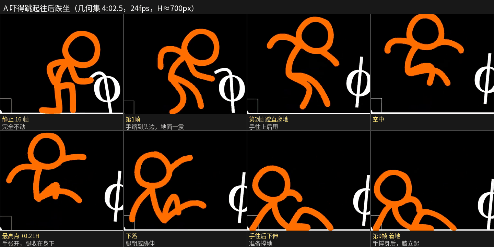
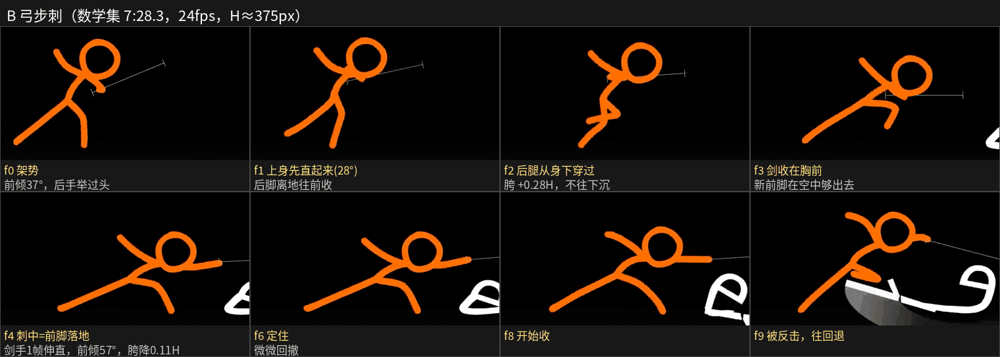
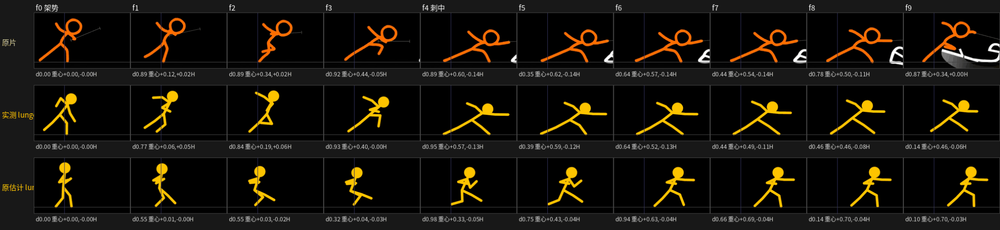
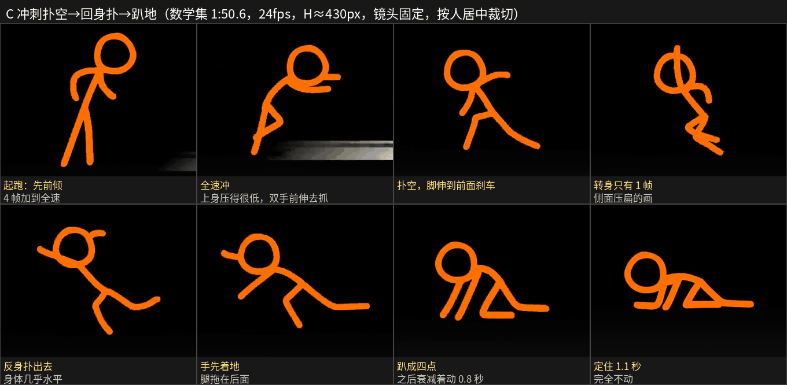
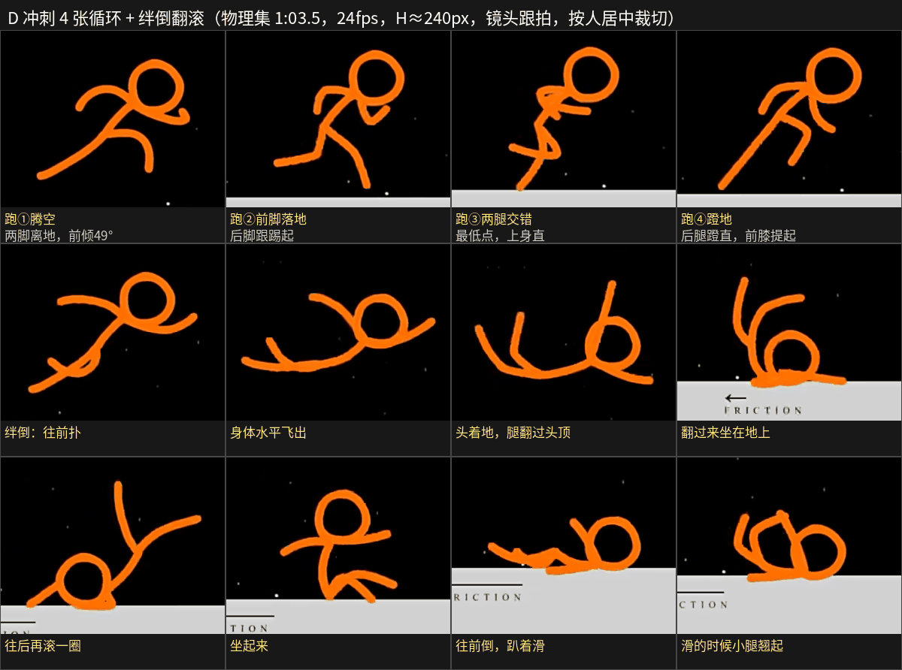
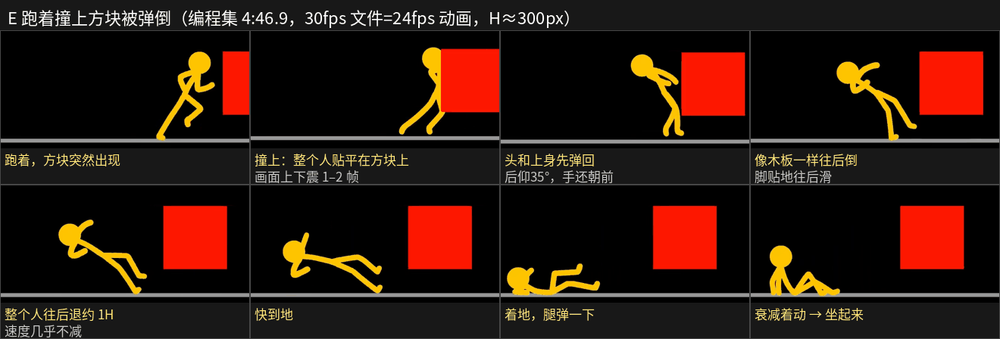
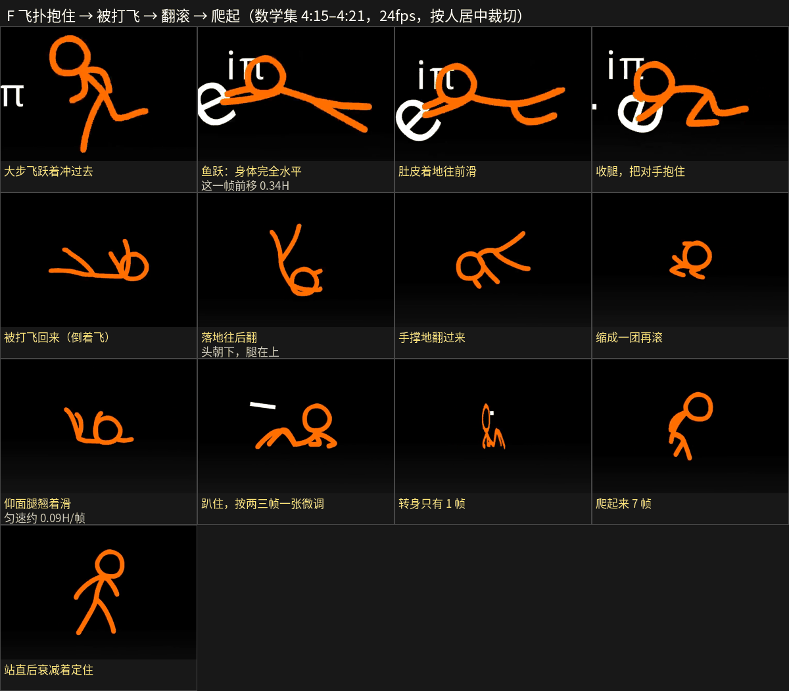

# 动作逐帧学习笔记：四集原片（编程 / 数学 / 几何 / 物理）

> 这是 `动作设计.md` 的证据：怎么设计、怎么实现看 `动作设计.md`，这里是逐帧量出来的数。
> 每个动作按原生帧率逐帧拉出来（`analysis/ref_track.py` 逐帧条 + 洋葱皮 + 每帧差异 d；`ref_grid.py` 单帧加坐标网格手量关节；`ref_headsize.py` 量头换算身高；`ref_cam.py` 用场景里不动的东西估镜头；`ref_board.py` 出关键帧展板）。展板全部可以用 `bash analysis/motion_boards.sh` 重新生成。
> 长度单位都是**站立身高 H**；"帧"都是 24fps 的帧（原片动画的帧率）。

## 0. 先纠正四件事

1. **编程集的 30fps 是 24fps 动画转出来的**：每 5 帧有 1 帧和上一帧完全一样（实测第 3、8、13、18、23、28… 帧 d=0.00）。所以编程集里数出来的"停 2 帧"有一部分只是转帧重复，不是真的定格。以前 30fps 下的数字要乘 0.8 才是原片帧数（比如"跑步每步 5 帧" = 24fps 的 4 张画）。
2. **橙色主角的头是 1/3 身高，不是 0.23H**。站直的帧直接量（头顶到脚底 vs 头外径）：数学 1:49.6 是 138/427=0.32，4:21.0 是 108/330=0.33，几何 2:12 是 0.30，物理 1:40–2:20 是 0.33–0.34。橙色角色的比例大约是：头 0.32H、躯干 0.28H、腿 0.38–0.42H、线宽 0.06H。黄色主角（编程集，实心头）站直量出来是 0.20–0.23H，和 `拆解` 1.3 节、`rig.js` 的 `headR: 0.115` 一致——**那套比例只适用于黄色角色**；以后用橙色空心头角色，要换一套比例。
3. 抽帧工具的坑：`ffmpeg -ss` 默认的恒定帧率输出会把第一帧复制一份（第 0、1 帧一样，看起来像停了一帧）。`analysis/ref_common.py` 里统一加了 `-map 0:v -fps_mode passthrough`。另外 `-ss 秒` 取单帧时拿到的是时间 ≥ 这个值的第一帧，写帧号前先用 `ref_track.py` 核对。
4. **自己量的数也要做出来验证**：B 弓步刺第一版的表里，刺中帧"胯降 0.19H、前倾 64°"，把数据做成动作、和原片同帧对比时发现对不上，放大重量是 **胯降 0.11H、前倾约 57°**（下面的表已改）。只看不做，错了也发现不了。

## 1. 从 6 个动作里总结出来的规律

| # | 规律 | 证据 |
|---|---|---|
| 1 | **动作期间每一帧都是新画**（24fps、一拍一）：帧间差 d 一直在 0.5–0.95 | A、B、C、D、E、F 全部如此 |
| 2 | **低能量的时候降到一拍二、一拍三**：趴着喘、爬、微调，都是"动一下 → 停 2–3 帧 → 再动一下" | C 趴地、F 趴着转身前后 |
| 3 | **完全定格**：一个情绪点上 d=0.00，0.5–1.1 秒一动不动，没有任何待机晃动 | A 吓之前静止 16 帧；C 趴地后定 27 帧（1.1 秒）；F 扭打后定 2 帧 |
| 4 | **衰减着落定**：一个大动作落到最终姿势后，后面 4–8 帧的变化量一路减小（0.7 → 0.3 → 0.1 → 0），然后才定住。不是一下子停死，也不是一直晃 | C：0.74, 0.10, 0, 0.10, 0.21, 0.12, 0.03, 0.03, 0；F 扭打：0.41, 0.42, 0.33, 0.26, 0.24, 0.06, 0.11, 0, 0 |
| 5 | **没有往反方向的预备**：快动作直接往目标方向走。所谓"预备"是先往**上**提一下（上身先直起来、身子先挺一下），而不是往后拉 | B 刺之前上身从 39° 直起到 18–24°；A 起跳前两帧先慢后猛 |
| 6 | **最快的那一下只用 1 帧**：刺出去的手 1 帧伸出 0.7H；鱼跃这一帧整个人前移 0.34H；转身也只有 1 张压扁的侧面画 | B f3→f4；F 255.28；C 111.43、F 260.13 |
| 7 | **身上没有拖影**：这 6 个动作里，人的手脚快速移动都是直接跳过去，不画拉长的弧线。拖影只出现在武器上（剑扫过时的白色扇形，持续 1–2 帧）；刀剑相碰是 1 帧白色光团 + 几根火花短线，再留 1–2 帧碎线 | B 7:24–7:29 |
| 8 | **冲刺跑 = 每步 4 张画，两条腿共用同一套**（火柴人分不清左右腿）：腾空 → 前脚落地 → 两腿交错（最低点）→ 蹬地。全力冲刺时上身往前倾 35–50°，和编程集慢跑时往后仰 10° 是两种跑 | D 63.55–63.68 每 4 帧重复；C 起跑 |
| 9 | **摔、翻、滚全程一拍一，大约 1 秒**：绊倒到趴下 26 帧；滚一圈约 6 帧；仰面滑行时速度几乎不变，到停的时候才突然停住 | D、F |
| 10 | **撞击时镜头配合**：画面上下震 1–2 帧（约 0.02–0.05H）；原来跟着人走的镜头在撞上以后用约 0.6 秒缓出停下；动作结束后镜头再用 0.7 秒左右的缓入缓出把构图摆正 | E 方块和地面的位置；F 扑倒后 |
| 11 | **爬起来很快**：从趴着到站直 7 帧（0.3 秒），站直后再衰减着动 10 帧左右才定住 | F 260.46–261.13 |

## 2. 逐个动作

### A 吓得跳起、往后跌坐（几何集 4:02.5，H≈700px）

- 静止 16 帧（d=0.00）→ 第 1 帧反应（手瞬间缩到头边，地面线跟着一震）→ 第 2 帧腿蹬直离地 → 第 5 帧到最高点 → 第 9 帧屁股着地，一只手撑在身后、膝盖立起 → 两帧一张慢慢稳住 → 镜头 6 帧快速拉远。
- 从动到着地 **9 帧（0.375 秒）**；重心上升 0.21H、往后退 0.29H。
- 每帧竖直位移（H）：-0.02, -0.03, -0.08, -0.06, -0.02（最高点）, +0.03, +0.07, +0.10, +0.14 → 着地。起跳先慢两帧再猛冲，下落像重力一样越来越快。

### B 弓步刺（数学集 7:28.3，H≈375px，镜头固定）

不是原地往前一扎，而是**后腿从身下穿过去变成新的前腿**（跨一步再刺）。f0 = 448.32s（第 0 帧取 `-ss 448.31`），网格放大逐帧手量：

| 帧 | 姿势 | 胯（相对 f0，[前, 下]） | 上身前倾 | 剑手（相对肩，[前, 下]） | 后手（相对肩） | 脚（相对 f0 的胯，[前, 离地]） |
|---|---|---|---|---|---|---|
| f0 | 架势：两脚分开 0.55H，后手举过头顶往后 | [0, 0]（胯离地 0.40H） | 37° | [0.15, 0.09] | [-0.23, -0.22] | 前 [+0.14, 0]，后 [-0.41, 0] |
| f1 | 上身先直起来，后脚离地往前收 | [0.15, -0.02] | 28° | [0.02, 0.07] | | 后脚 [-0.24, 0.13] |
| f2 | 后腿从身下穿过（膝盖在前、脚收在胯下），原前脚还踩着 | [0.28, -0.01] | 22° | [0.03, 0.02] | | 摆动脚 [+0.16, 0.23] |
| f3 | 剑收在胸前（水平），新前脚在空中往前够 | [0.40, 0.01] | 49° | [0.00, 0.10] | | 摆动脚 [+0.59, 0.16]；蹬地脚往后滑到 -0.10 |
| **f4** | **刺中 = 前脚落地的同一帧**；剑手 1 帧伸直（手在画面里走了约 0.7H） | [0.52, **0.11**]（胯离地 0.29H） | **57°** | [0.53, 0.03] | [-0.31, -0.20] | 前 [+0.88, 0]，后 [-0.05, 0]；后腿和上身几乎连成一条直线 |
| f5 | 还往前冲一点（过冲） | [0.55, 0.11] | 54° | | | 不动 |
| f6–f7 | 往回收，每帧 0.03–0.08H | [0.47 → 0.44, 0.12] | 52 → 50° | | | 不动 |
| f8–f9 | 被对方反击，快速往回退 | [0.40, 0.07] → [0.28, 0] | | | | |

- 胯一直往前走（每帧 +0.15, +0.13, +0.12, +0.12），前三帧高度不变甚至略升（"先往上提"），**下沉 0.11H 全在刺中那一帧**；刺中后再过冲 1 帧才往回收。
- **极限姿势时四肢被拉长**：剑手离肩 0.53H（我们骨骼手臂伸直只有 0.375H）；后脚离胯水平 0.57H、竖直 0.29H，直线 0.64H（腿长约 0.4H）。手绘可以这样画，我们的骨骼会被关节长度限制住。
- 姿势跨度：刺到底时从后脚到剑手横向约 1.4H，高度只有约 0.7H。
- 对比我们原来估计的 `lunge_punch`：先往后预备 3 帧、第 7 帧才打中、上身只倾 26°、胯只降 0.06H。
- **已做成动作并对比**：`analysis/fight_moves.json` 的 `fence_guard`（f0 架势）+ `lunge_step`（f1–f8）。下图上一行原片，中间实测版（含拉长），下面原来的估计版（两个都从架势开始；`render/src/tools/move_seq.js` 按 24fps 渲，`analysis/ref_compare.py` 按 H 缩放、第 0 帧对齐）：

| 帧 | f1 | f2 | f3 | f4 刺中 | f5 | f6 | f7 |
|---|---|---|---|---|---|---|---|
| 原片 d / 重心前移 | 0.89 / 0.12 | 0.89 / 0.34 | 0.92 / 0.44 | 0.89 / 0.60 | 0.35 / 0.62 | 0.64 / 0.57 | 0.44 / 0.54 |
| 实测版 | 0.77 / 0.06 | 0.84 / 0.19 | 0.93 / 0.40 | 0.95 / 0.57 | 0.39 / 0.59 | 0.64 / 0.52 | 0.44 / 0.49 |
| 原估计版 | 0.55 / 0.01 | 0.55 / 0.03 | 0.32 / 0.04 | 0.98 / 0.33 | 0.75 / 0.43 | 0.94 / 0.63 | 0.66 / 0.69 |

  节奏（d）和重心路线基本对上了。剑手和后腿原来被骨骼长度限制住（手臂伸直只有 0.375H），现在 f3–f8 写了 `st`（允许手脚拉长到 1.45 倍），刺中帧后脚到剑手那条长直线出来了。剩下的差别：头小（黄色角色比例）、f1–f2 重心慢一点（头和躯干比例不同，重心位置不一样）。

### C 冲过去扑空 → 回身扑 → 趴在地上（数学集 1:50.6，H≈430px，镜头固定）

- **起跑**：站着先往前倾 2 帧，然后每帧 0.07、0.11、0.10、0.14H，4 帧就到全速；全速每帧 0.13–0.21H（约 3–5H/秒）。上身压得很低，双手一直往前伸（要抓东西的跑法），**每步约 3 帧**。
- **扑空**：脚伸到身前刹车 → 回头 → **1 帧侧面压扁的转身画** → 反身扑出去，身体几乎水平 → 手先着地 → 趴成四点。扑回去这段约 10 帧走了 1.0H，最快那一帧 0.14H，最后两帧重心下沉 0.17H。
- **趴着**：先衰减着动 20 帧（喘气、调整，d 0.1–0.7）→ 定 4 帧 → 抬头往回看 → 整个人塌下去，衰减 8 帧 → **定住 27 帧（1.1 秒）** → 8 帧坐起来跪坐。

### D 冲刺 + 绊倒翻滚（物理集 1:03.5，H≈240px，镜头跟拍）

冲刺 4 张循环（每步 4 帧 = 每秒 6 步；脚的坐标相对胯，[前, 离地]）：

| 画 | 姿势 | 前倾 | 胯离地 | 前脚 | 后脚 |
|---|---|---|---|---|---|
| ① 腾空 | 两脚都离地，前腿提膝、小腿垂下，后腿伸直拖在后面；后手往后上方甩，前手弯在胸前 | 49° | 0.46H | [+0.24, 0.25] | [-0.42, 0.20] |
| ② 落地 | 前脚快踩到地，后脚跟踢起来 | 36° | 0.44H | [+0.28, 0.07] | [-0.29, 0.22] |
| ③ 交错 | **最低点**（头比①低 0.05H），上身几乎竖直，两手在胸前交叉 | 约 0° | 0.39H | 支撑脚 [-0.15, 0] | 摆动脚收在胯下 |
| ④ 蹬地 | 后腿蹬直、脚尖点地，前膝提起 | 37° | 0.47H | 膝 [+0.18]、脚 [+0.10, 0.20] | [-0.34, 0.05] |

- 支撑脚相对胯每帧往后滑约 0.3H，说明实际速度约 7H/秒（镜头跟着人走，背景星点在动）。
- 绊倒：往前扑 → 身体水平飞出 → 头着地、腿从头顶翻过去 → 翻过来坐着 → 往后再滚一圈 → 坐起 → 往前倒、趴着滑（小腿翘起来）。从绊倒到趴下 **26 帧，全部一拍一**，翻一圈约 6 帧。

### E 跑着撞上方块被弹倒（编程集 4:46.9，黄色角色，H≈300px）

- 撞上那一帧：整个人**贴平**在方块上（头、胸、胯在一条竖线上），画面上下震 1–2 帧。
- 下一张：**头和上身先弹回来**（后仰约 35°，头离开方块 0.33H），胯和脚还在原地，手还朝前伸——像鞭子一样从头开始传。
- 然后整个人像木板一样往后倒，脚贴地往后滑；相对方块共退约 1.0H，**速度几乎不减**（每帧约 0.1H），着地时腿弹一下，衰减着动 6 张，再用 4 张坐起来。
- 镜头：本来跟着人往右走（每帧约 100px），撞上以后用约 0.6 秒缓出停下（14, 14, 13, 11, 12, 8, 10, 7, 7, 5, 5, 3, 3, 1, 1px/帧）。

### F 飞扑抱住 → 被打飞 → 翻滚 → 爬起来（数学集 4:15–4:21）

- **飞扑**（H≈490px）：大步飞跃着过去（每步之间身体越来越低）→ **鱼跃那一帧身体完全水平，一帧前移 0.34H** → 肚皮着地往前滑 3 帧（腿往上翘）→ 收腿，把对手抱住。
- 抱住以后：对手被推开，位移是缓出（每帧 -0.24, -0.11, -0.09, -0.07, -0.05, -0.03, -0.01H）；两人一起慢慢往回挪 16 帧（缓入缓出）；扭打的动作衰减 8 帧后定住。
- **被打飞回来**（H≈335px）：倒着飞进画面 → 落地往后翻（头朝下、腿在上）→ 手撑地翻过来 → 缩成一团再滚 → 仰面腿翘着滑（匀速约 0.09H/帧）→ 趴住。这一段 28 帧全部一拍一。
- **趴着**的时候换成一拍二 / 一拍三（动一下停 2–3 帧）→ **1 帧转身** → 7 帧爬起来 → 站直后衰减 10 帧定住。

## 3. 怎么用到片子里

怎么设计（七个问题）、设计怎么落到代码、每个动作的设计拆解（动作卡），都在 `动作设计.md`。

## 4. 复现
- 展板和对比图：`bash analysis/motion_boards.sh [参考片目录]`（里面有每张图用的时间点和说明）。
- 逐帧条 / 洋葱皮 / 每帧数据：`python3 analysis/ref_track.py 视频 起点 终点 输出名 --box …`（各节标题里有原片时间）。
