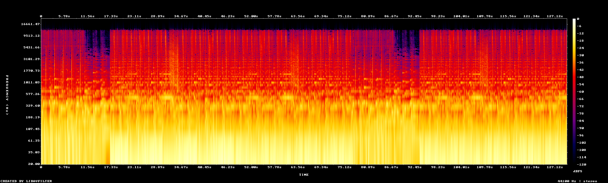
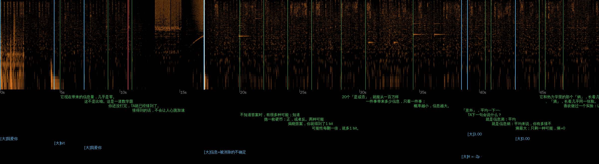
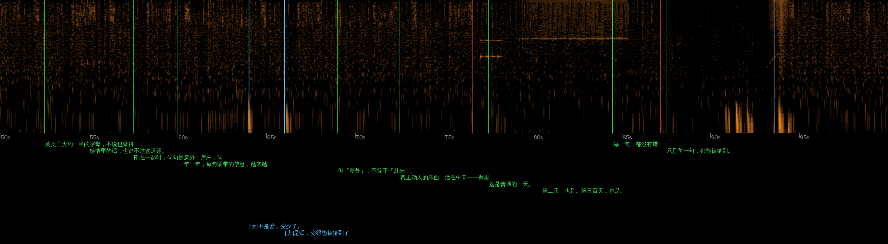
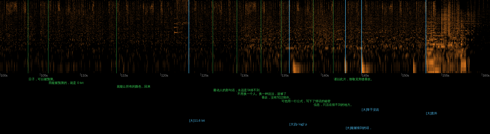
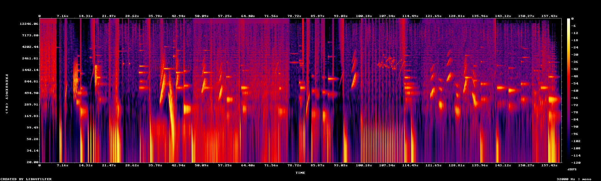

# 比特新语 · 七个视频拆解

> 素材：`claude-比特心语` 分支 `reference-videos/比特心语/` 里的 7 个 B 站视频（BV12DHQ61EhT、BV1Fbpt6qEPq、BV1WkJk6VEqA、BV1cvpF6fEoc、BV1XWp76FEZR、BV1VVpo6gEMw、BV1zVpJ6yEk6）。
> 方法：
> - 每 2 秒抽一帧，逐张看；关键处每 0.1 秒一帧。
> - OCR 提取全片字幕和时间（`tools/ocr2.py`、`tools/lines.py`）。
> - 语音识别确认有没有旁白。
> - 把视频音轨和 BGM 对齐、相减，单独拿出音效层看频谱（`tools/sfx_isolate.py`）。
> - 算出 BGM 的节拍和段落（`tools/beatgrid.py`）。
>
> 下文的时间都是视频里的秒数。"v2" 这类编号见文末附录。

---

## 0. 结论先行（七条最重要的发现）

1. **没有旁白。** 七个视频全靠屏幕字幕叙事。语音识别在 160 秒里只检出 0～6 秒的"人声"，全是音乐里的哼唱。
   - 观众是"读"完一个故事的，所以字幕的节奏就是视频的节奏。
2. **六个视频用的是同一首 BGM，而且就是仓库里的 `reference-videos/BGM.m4a`。**
   - 在同一时刻比对，相似度 0.95～0.999。只有 v1（冰立方，3:20）换了曲子。
   - 视频里的音乐 = `BGM.m4a` 的 0～130 秒，再把 100.2 秒之后那段接着重复一遍，凑到约 2:40。
   - 换句话说：**他不是给每个视频找音乐，而是给一首固定的音乐写不同的故事。** 结构是被音乐锁死的。
3. **片名永远砸在 17.05 秒。** 那是 BGM 的第一个"落点"（drop）。
   - 前面约 17 秒是冷开场钩子，后面是正文。
   - 第二个落点在 93.57 秒，七个视频都在这里"翻转"：换问法、换尺度、情绪爆发。
4. **一个视频只讲一件事，用一个画面贯穿首尾。**
   - 比如：领奖台、"到家了吗？"的聊天气泡、"我爱你"的对话框、一艘绕圈的赛艇、一粒衣藻。
   - 开头出现，结尾回来，意思已经变了（首尾呼应）。
   - 这和我们之前"11 条定律、每条 8.5 秒"的清单式结构正好相反。
5. **每句字幕都有一个画面动作与之对应。** 字说"翻了一倍"，画面上的分叉树就分一次。
   - 场景是连续的"一个世界"，不是一张张换卡片。
   - 一个场景通常撑 4～8 句字幕，画面跟着字幕一步步变。
6. **音效很少，只用来点题。** 不是一句一个"嗖"。主要是四类：
   - 画面里那个东西本身的声音：电视雪花、人群、计时滴答、消息提示音。
   - 大字砸出来时的一记低音。
   - 进入 drop 之前的上扬音（riser）。
   - 段落空白处一条持续的细音。
7. **结尾公式固定**，依次是：
   1. 回到开头的画面。
   2. 一句"人话"的道理。
   3. 一句"致每一个……的人"。
   4. 片尾标题卡，配参考文献或人物署名。

---

## 1. 音乐：所有东西都挂在这张表上

BGM：112.9 BPM，一小节 2.126 秒，相位 0.04 秒。下表是 `tools/beatgrid.py` 算出的每小节能量。"高频"指 6 kHz 以上的能量，接近 0 说明那段被滤掉了，听感是"闷住、憋着"。

| 时间（秒） | 小节 | 音乐 | 七个视频在这里做什么 |
|---|---|---|---|
| 0 – 10.67 | 0–4 | 前奏，有律动 | **冷开场**：一个具体、反常识的场景 + 2～4 句字幕 |
| 10.67 – 17.05 | 5–7 | 高频被滤掉，憋着 | **钩子收紧**：抛出问题，或把场景推到极致 |
| **17.05** | 8 | **第一次落点** | **片名砸出来**：白闪 0.1 秒、发光大字、英文小副题、一行问句 |
| 17.05 – 76.57 | 8–35 | 主段，满能量 | **讲原理**：两三个"台阶"，每个台阶一个场景，越讲越深 |
| 76.57 – 87.2 | 36–40 | 能量降 3～4 dB | **落到人身上**：普通的一天、每个人都领过自己的银牌、无风带 |
| 87.2 – 93.57 | 41–43 | 高频又被滤掉 | **悬念**：直到有一天——、反事实、"再看十个点" |
| **93.57** | 44 | **第二次落点** | **翻转 / 高潮**：粒子炸开、换一种问法、风暴、大脑地图 |
| 93.57 – ~140 | 44–… | 主段 | 新尺度上的第二轮论证，或者把原理用回生活 |
| ~140 – ~152 | | 主段尾 | **回到开头的画面** + 一句道理 |
| ~152 – 160 | | 收尾 | **片尾标题卡** + "致每一个……" |

**七个视频在第二次落点（93.6 秒）都换了一次大场面：**

| 视频 | 76.6 秒（降下来） | 87–93 秒（憋着） | 93.6 秒（落点） |
|---|---|---|---|
| v4「我爱你」 | "这是普通的一天" + 364 天的格子 | "直到有一天——" | 格子炸成彩色流线："一次意外，就能让所有的颜色回来" |
| v3 银牌 | "其实，每个人都领过自己的银牌" + 地铁门 / 599 分 | "差一点就在一起的人" | "但先别急着同情银牌"：反事实让人进步 |
| v5 风 | 帆船停在无风带："帆垂下来" | 上升的空气 | 咆哮西风带，信天翁出场 |
| v6 光遗传 | 光第一次照进活小鼠的大脑 | 用光点亮记忆细胞，小鼠"僵住了" | "从那以后，脑科学换了一种问法"，大脑地图 |
| v7 刷分 | "不写规则，让人来打分" | 聊天 AI 讨好人 | "盯着它的思考过程"，代码终端 |
| v2 剃刀 | "现在，回到那条没回的消息" | "而睡着了，只押了一次注" | "再看十个点"，过拟合 |

v5 最妙：音乐闷住的那一段，画面正好是"无风带"；音乐炸开，画面正好是"最猛的风"。**音乐的结构被拿来演内容。**

### 这对我们意味着

- 拿到一首 BGM，第一步是先算出这张表（落点、空白、段落）。然后写文案时**按格子填**，不是写完再去对音乐。
- 用户说"BGM 我有"，就是这首 `BGM.m4a`。要做 2:40 的版本，需要把 100.2 秒那段按 14 小节（29.76 秒）接一次，拼接点要落在小节线上。
- 响度：「我爱你」整片 −10.1 LUFS，BGM 几乎是原音量；银牌 −16.1 LUFS，BGM 压低了约 6 dB，给音效让位。音乐是主角，音效只点缀。



---

## 2. 内容结构：一个故事，不是一张清单

### 2.1 固定骨架

```
[冷开场 0–17 秒]   一个具体到秒的生活场景 / 反常识的数字
                   "这句「我爱你」，你已经说了 1000 遍。它带来的信息量，几乎是零。"
                   "他三个小时，没回消息。你的脑子，已经替他想好了一百种解释。"
                   "领奖台上，第二名笑不出来。第三名，却笑得像赢了。"
                   "你闻到的海的味道，其实不是盐。"
                   "这艘船，从来不去终点。"
                   "他已经很多年，看不见任何东西了。2021 年，他重新数出了斑马线。"
[片名 17 秒]       两到四个字的大标题 + 英文副题 + 一个问句
                   剃刀 / 意外 / 银牌的眼泪 / 风的方向 / 擦肩 / 趋光 / 刷分的捷径
[原理阶梯]         1. 一个历史起点：年份 + 人名 + 一句话（"1992 年，心理学家关掉声音、遮住名次——"）
                   2. 核心概念用一句"等式"说清（信息 = 被消除的不确定性）
                   3. 2～3 个递进的实验或案例，每个都有一个能动的数字
[落到人身上 76 秒] 回到普通人的日常
[翻转 93.6 秒]     "但是 / 直到有一天 / 从那以后"，换尺度或换视角
[回扣]             开头那个画面回来，意思变了
                   （领奖台多了"第四个人"；赛艇终于开到终点；衣藻和人一起"朝着光游"）
[金句 + 致敬]      "能被猜到的话，等于没说。" / "致每一个，还愿意让人意外的人。"
[片尾卡]           标题 + 参考文献（Medvec 1995、Kahneman & Tversky 1982……）或诺奖署名
```

### 2.2 选题的公式

**一个硬知识点 × 一种人人有过的感情。**

| 硬知识 | 感情落点 |
|---|---|
| 香农信息熵 | 老夫老妻说"我爱你" |
| 奥卡姆剃刀 + 过拟合 | 对方不回消息时的胡思乱想 |
| 反事实思维（心理学） | 差一点 |
| 海陆风 / 西风带 | 两个不一样的人才有风 |
| 光遗传学（诺奖） | 在黑暗里很多年的人 |
| 奖励作弊（AI 安全） | 刷分 vs 真心 |
| 中微子（诺奖） | 擦肩而过的人 |

**蹭热点的方式**：三个诺奖题（物理、生理医学、化学）都在颁奖当周发布，副题写"2026 诺贝尔××奖"。不是讲新闻，而是讲新闻背后那个"小东西"的故事。

### 2.3 文案的写法（逐句看下来的规律）

- **短句，一行一句。** 中位 12 个字，每句停 2～3 秒；整片 40～60 句。
- **用破折号制造停顿和悬念**："直到有一天——""穿过整个地球——""它学会了——盯着手指。"
  - 一句话常常拆成两屏：前半句停住，后半句揭晓。
- **数字具体到个位**："0.01 秒""第 426 天""11.6 bit""5160 只眼睛""96%"。数字一定在画面上"动"出来（滚动、倒数）。
- **概念先用人话说一遍，再给术语**：
  - "往上想：本可以更好——叫上行反事实。"
  - "把所有可能的「意外」平均一下——就是信息熵。"
- **对称句收束段落**：
  - "疼的时候，用来追；暖的时候，用来活。"
  - "简单的那条，输了昨天，赢了明天。"
  - "你盯得越紧，它藏得越深。"
- **第二人称**："你的脑子""你认识的那个人""平行宇宙里那个已经赢了的你"。
- **关键词上色**：每句最多一两个词，用主题色。
- **每个历史节点都给出处**：画面左上角放年份和人名，右上角放"慢放 ≈ 400 倍""示意，偏转已放大"之类的诚实标注。
- **结尾不说教，给一个动作**："今天，说一句 TA 猜不到的。""那就先信它。然后，睡吧。"

---

## 3. 画面语言

### 3.1 每个视频有一个主视觉，场景数控制在 6～9 个

| 视频 | 主视觉（首尾都出现） | 中间的场景 |
|---|---|---|
| v3 银牌 | 三人领奖台 + 聚光灯 | 跑道、"如果"大字、上行 / 下行反事实、机场航班表、599 分、地铁门、平行宇宙的你、奖牌 |
| v4 我爱你 | "我爱你"对话框 + 0 bit | 输入法联想、香农论文、二叉分叉树、信息量曲线、熵柱状图、逐字信息量、三种纹理、364 天格子、彩色流线 |
| v2 剃刀 | "到家了吗？" + 胡思乱想分叉网 | 剃刀片名、拉丁文格言、火星逆行、本轮套本轮、大象、开普勒椭圆、0.8⁵、过拟合曲线、水星进动 |
| v7 刷分 | 绕圈刷分的赛艇 | 积木机械臂、俄罗斯方块暂停、奶酪迷宫、清洁机器人、河内老鼠、规则越多越钻、机械手抓球、聊天讨好、代码作弊、手指和月亮 |
| v6 趋光 | 失明的人 + 粒子斑马线 | 衣藻、神经元网、反应速度对比、离子通道、青蛙卵、小鼠光纤、大脑地图、眼球护目镜 |
| v5 风 | 日落海面 | 水下浮游、海陆风循环、地球风带、无风带帆船、西风带巨浪、信天翁、地球航线、海边两人 |
| v1 擦肩 | 指纹 + 650 亿 | 手、地球、加速器、冰立方剖面、电缆、南极施工、星图、NGC 1068 |

**规律：**

- 场景都是"能看懂的实物隐喻"：领奖台、跑道、航班表、聊天气泡、迷宫、地铁门。纯图表很少，图表也一定长在一个实物上。
- 同一个场景里，摄像机和元素是连续的。字幕每换一句，画面只加一个变化：亮一个点、多一层分叉、数字滚一格。
- 换场景主要靠三种方式：
  - 跟着落点硬切。
  - 压暗后淡入（字幕在黑场里先出来）。
  - 镜头推进，进入某个元素内部（衣藻 → 眼点 → 离子通道）。

### 3.2 版式（1080p 实测）

| 元素 | 位置 | 字号（字高） | 样式 |
|---|---|---|---|
| 底部叙事字幕 | 居中，y≈900–1000 | 48–62 px | 思源宋体 / Noto Serif SC 粗体，白色 + 柔光，关键词上主题色 |
| 顶部叙事字幕（画面占满下方时） | 居中，y≈100–130 | 同上 | 同上 |
| 片名 | 正中 | 150–400 px | 宋体特粗，强发光，一次性色散；下面一行英文等宽小字（REWARD HACKING、OCCAM'S RAZOR） |
| 章节标签 | 左上，y≈80–120 | 中文 36 px + 英文 18 px | 中文宋体 + 英文等宽小字：`衣藻的眼点 / ALGAL EYESPOT · 0.01 mm` |
| 出处 / 年份 | 左上或右上 | 18–24 px | 等宽字体：`HARZ & HEGEMANN · 1991` |
| 大数字 | 画面一侧 | 80–200 px | 窄体无衬线（类 DIN），发光，逐位滚动 |
| UI 道具 | 场景内 | — | 聊天气泡、航班翻牌、终端、进度条，做得像真的 |

**文字动画（逐帧看到的）：**

- 字幕逐字出现，每秒约 10 字。每个字从模糊和透明过渡到清晰，大约 0.2 秒。关键词的颜色会顺着字"扫"过去。
- 字幕消失时整句淡出，0.3～0.5 秒。下一句马上接上，没有空等。
- 片名（银牌，从 16 秒起）：
  1. 16.1–16.6 秒：画面上的人"流下一滴泪"。
  2. 17.1 秒：整屏白闪一帧多。
  3. 片名从强光里出现，光晕 0.5 秒内衰减，下面一圈圈涟漪。
  4. 18 秒起，问句开始逐字打出。
  - 见 `图/银牌_片名逐帧.jpg`。

### 3.3 颜色和质感

- 底色永远是深色：黑、深蓝、深棕。一个视频只用 **一个主色 + 一个辅助色**：

  | 视频 | 主色 / 辅助色 |
  |---|---|
  | 我爱你 | 红 |
  | 剃刀 | 粉紫 + 金 |
  | 银牌 | 银 / 金 / 铜 |
  | 光遗传 | 青蓝 + 琥珀 |
  | 刷分 | 荧光绿 |
  | 风 | 暖橙 + 海蓝 |

- 全片带后期质感：
  - 轻微胶片颗粒和暗角。
  - 发光（bloom）：只给亮的东西。
  - 景深：前景和背景虚化。
  - 体积光：聚光灯、光柱。
- 3D 的东西一律低饱和、柔光、有软阴影（积木、机械手、奶酪迷宫、地球、海面）。看起来像 Three.js 或 WebGL 做的，不是三维软件渲染的。
- "华丽"的瞬间一个视频只有两三次，留给片名、93.6 秒的落点和结尾；其他时候画面是安静的。

---

## 4. 音效：少而准

把每个视频的音轨减去对齐的 BGM，得到纯音效层。下面四张图是「我爱你」和银牌的音效层频谱：

- 绿线：叙事字幕出现。
- 蓝线：大字出现。
- 白线：音乐落点。
- 红线：音乐滤波段开始。






### 读出来的规律

1. **大部分字幕没有音效。** 在「我爱你」里，字幕出现的时刻和音效出现的时刻，重合比例跟随机差不多。
2. **画面里有声音的东西才响**，而且是"拟真"的声音：

   | 视频 | 时间 | 声音 | 对应画面 |
   |---|---|---|---|
   | 我爱你 | 12.8–16.8 秒 | 宽带白噪声 | 电视雪花 / 香农论文 |
   | 我爱你 | 122 秒 | 几声短提示音 | 消息弹出："我在你公司楼下" |
   | 我爱你 | 76–85 秒 | 一条 2～3 kHz 的持续细音 | 平淡日子的格子 |
   | 银牌 | 0–5 秒 | 人群噪声 | 赛场 |
   | 银牌 | 100–112 秒 | 规则的滴答串 | 0.010 → 0.000 秒倒数 |
   | 银牌 | 107 秒 | 1.5–2.5 kHz 闪烁颗粒声 | 分叉树长出粒子 |

3. **落点前有上扬音**：「我爱你」16 秒处一条上滑的扫频，正好落进 17.05 秒；银牌 8 秒、10 秒、16 秒、37 秒都有上滑音。
4. **大字砸出来配一记低音**（100 Hz 以下）：「我爱你」63.5 秒"不是爱，变少了"、65.8 秒"是话，变得能被猜到了"、136 秒公式、144.6 秒"等于没说"、153 秒片尾"意外"。整片也就五六次。
5. **93.6 秒的落点**：一记低音炸开，加上粒子声。
6. 银牌比「我爱你」音效多：上滑音和短促的音调声（"叮"）明显更多。但还是一个个单独的事件，没有"每句字幕都嗖一下"。

> 对照我们 Pluto 那版：26 种音效铺满全片，转场一律"闪光 + 呼啸"。比特新语的做法是：先问这个画面里的东西会不会发出声音，会才加。

---

## 5. 标题和封面

- **标题 = 反常识陈述 + 具体数字 / 括号副题**：
  - 「我爱你」说到第 1000 遍，信息量几乎为零
  - 《剃刀》每一个也许都要付钱：0.8⁵ = 33%
  - 《银牌的眼泪》｜最痛的，不是失败，是"差一点"
  - 两个一模一样的地方之间，是不会起风的
  - 今年诺奖颁给了"大脑的开关"：光遗传学到底是什么
- **封面** = 片中最好看的那一帧 + 两行字：
  - 上面一行小字设问："最让人上头的概率，"
  - 下面一行大字给答案或反转，答案里一个词上色："不是 100%"
  - 或者直接用片名大字，比如"意外"做成噪点字。
  - 封面字都是衬线粗体，多数放在画面上方或左上。
- **播放量对照**：最高的是银牌（209 万）和光遗传（177 万）。它们的共同点：
  - 情绪落点最普世（"差一点"、"黑暗里的人重新看见"）。
  - 主视觉最"像电影"（聚光灯领奖台、发光神经元）。

---

## 6. 对照我们以前的作品

| 维度 | 我们之前（anxiety / reality） | 比特新语 |
|---|---|---|
| 一个视频讲几件事 | 11 条定律，每条 8.5 秒 | 1 件事，讲透 |
| 结构 | 清单，一张张卡片 | 冷开场 → 片名 → 原理阶梯 → 落到人 → 翻转 → 回扣 → 金句 |
| 主视觉 | 每张卡一个新图表 | 一个主视觉贯穿首尾，6～9 个连续的场景 |
| 画面 | 2D 图表为主（skia-canvas） | 实物隐喻 + 3D + 光影 + 景深 |
| 文案 | 道理和口号多（"自律才是自由的最终形态"） | 具体场景、数字、第二人称，结尾给一个动作 |
| 音乐 | 同一首 BGM，落点也找对了 | 同一首 BGM，而且两个落点、两段滤波都演成了内容 |
| 音效 | Pluto 用 26 种音效铺满全片；never / teeth 画面跟着鼓点震动 | 只给"会响的东西"和大字 |
| 出处 | 记忆里的数字，未核实 | 画面里直接标年份、人名、论文 |

anxiety 用的就是这首 BGM，17.09 秒和 93.6 秒也都找对了。**差距主要不在技术，在"一个视频只讲一件事"和"画面是一个世界"这两条。**

---

## 7. 我打算怎么做

### 7.1 技术路线：Remotion（React）+ Three.js

判断依据：

- 他的字幕柔光、逐字模糊、聊天气泡、航班翻牌、终端，都是网页（HTML/CSS）最擅长的。
- 积木、地球、海面、粒子大脑是 WebGL。
- 频道简介写着"用 AI 把知识拍成大片"。主页上能看到的 10 个视频，都是 10 月 6 日到 15 日这十天里发的，而且六个共用同一首 BGM、同一套版式。说明他有一套能快速复用的"代码模板"。

所以：

- **Remotion**：按帧确定渲染、能多进程、能出 1080p / 4K。仓库 `pluto-demo` 分支已经用过。
- **@remotion/three + react-three-fiber** 做 3D 场景，配后期 bloom、景深、颗粒。
- 你的机器渲染时，用 GPU 跑 Chrome（`--gl=angle` 或 `vulkan`），3D 场景会快很多。

### 7.2 先搭一套"比特新语式"的引擎，以后每期只写故事

一次性做好、每期复用：

1. **BGM 时间轴**：读 `BGM.m4a` 的节拍表，提供 `bar(8)`、`DROP1`、`DROP2` 这些常量。按 14 小节接成 2:40 的版本，拼接点落在小节线上。
2. **文案文件**：每句一行，写上挂在哪一小节、哪一拍、关键词。字幕时间自动排，画面动作挂在字幕上。
3. **通用组件**：
   - 逐字字幕（模糊 → 清晰、关键词扫色）
   - 片名卡（白闪 → 发光 → 涟漪，只用一次）
   - 章节标签
   - 出处角标
   - 滚动数字
   - 片尾卡
4. **后期**：颗粒、暗角、发光、景深。色散只给片名用。
5. **音效库**：十来种，可以程序合成，也可以用你手上的素材。只在"实物会响"、"大字砸下"、"落点前"三种地方下音效，响度目标约 −14 LUFS。
6. **自查工具**：就是这次写的 `tools/`。
   - 渲染完先跑 OCR，看字幕密度。
   - 对齐 BGM 相减，看音效层。
   - 和参考视频的同一张表对比，确认节奏一致。

### 7.3 每一期的流程和分工（建议）

| 步骤 | 谁 | 产出 |
|---|---|---|
| 1. 选题 | 一起：我出几十个候选，你挑 | 硬知识 × 情绪落点 × 标题 |
| 2. 查资料、写文案 | 我 | 按 BGM 格子写好的逐句文案 + 出处清单 |
| 3. 核对 | 你（必要时我联网查） | 数字和出处确认 |
| 4. 分镜 | 我 | 每段一张关键帧，先给你看风格对不对 |
| 5. 写代码 | 我 | 推到 GitHub |
| 6. 渲染 | 你 | 成片 |
| 7. 自查 | 我（你把成片或片段传回来） | 字幕节奏、音效、对齐 BGM 的检查报告 |
| 8. 标题和封面 | 我出 3～5 套，你定 | 封面图由代码直接渲染 |

### 7.4 我自己会注意的几条

- 写文案前先填好第 1 节那张表：每个格子放什么。
- 每个场景先问三个问题：
  - 观众一眼看得懂吗？
  - 这个东西在现实里长什么样？
  - 它会发出声音吗？
- 数字一律标出处。查不到的不用。
- 华丽只给三个时刻：片名、93.6 秒、片尾。

---

## 附录 A：七个视频编号

| 编号 | 标题 | 时长 | BGM |
|---|---|---|---|
| v1 | 2026 诺贝尔物理学奖，冰立方中微子（擦肩） | 3:19 | 另一首 |
| v2 | 《剃刀》每一个也许都要付钱：0.8⁵ = 33% | 2:39 | BGM.m4a |
| v3 | 《银牌的眼泪》｜最痛的，不是失败，是"差一点" | 2:41 | BGM.m4a |
| v4 | 「我爱你」说到第 1000 遍，信息量几乎为零 | 2:44 | BGM.m4a |
| v5 | 两个一模一样的地方之间，是不会起风的（风的方向） | 2:41 | BGM.m4a |
| v6 | 今年诺奖颁给了"大脑的开关"：光遗传学到底是什么（趋光） | 2:41 | BGM.m4a |
| v7 | 刷分的捷径 | 2:41 | BGM.m4a |

每个视频的抽帧总览在 `图/总览_vN.jpg`。逐句字幕是 OCR 识别的，有少量错字，见 `字幕转写.md`。

## 附录 B：工具怎么用

```bash
pip install numpy scipy rapidocr-onnxruntime pillow
mkdir -p work/an work/sfx work/audio
python3 study/比特心语拆解/tools/ocr2.py 视频.mp4 work/an/o_v4.json        # 2 fps 整帧 OCR（约 2 分钟）
WORK=work/ python3 study/比特心语拆解/tools/lines.py v4                    # 合并成逐句字幕时间线
python3 study/比特心语拆解/tools/sfx_isolate.py 视频.mp4 reference-videos/BGM.m4a work/sfx/v4   # 减掉 BGM，留下音效层
WORK=work/ python3 study/比特心语拆解/tools/sfxplot.py v4 0 50 out.png     # 音效层频谱 + 字幕标注
python3 study/比特心语拆解/tools/beatgrid.py reference-videos/BGM.m4a      # BGM 节拍、每小节能量
```
